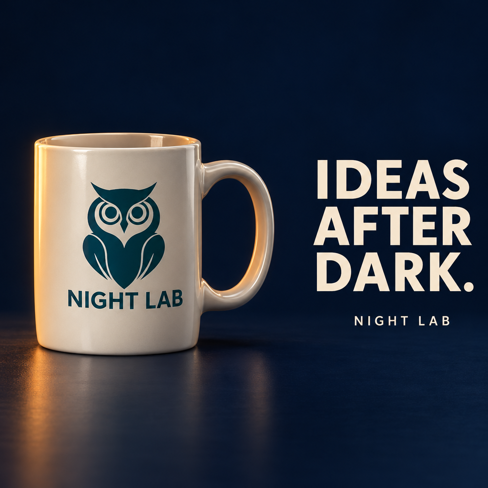
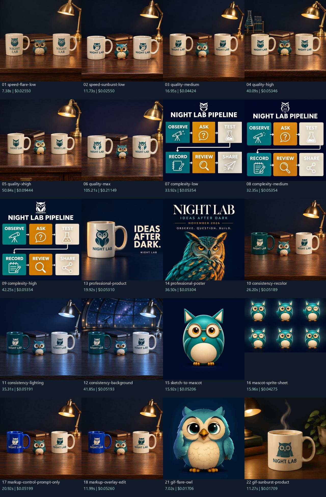
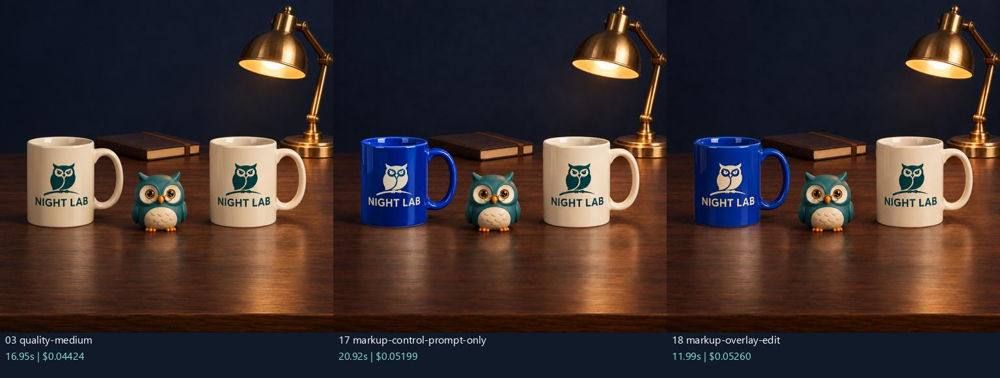
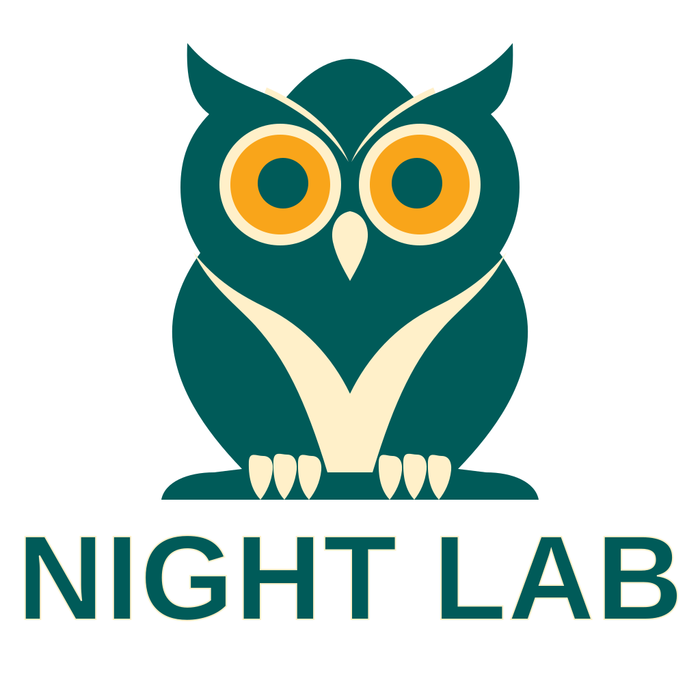
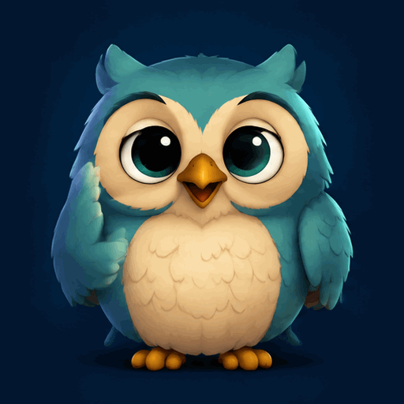

# GPT Image 2.6 — Night Lab

An illustrated, inspectable feature tour of **GPT Image 2.6 Sunburst and Flare**: 22 API outputs, exact prompts and settings, controlled comparisons, elapsed timings and token-based costs.

**Recorded run:** 18 PNG stills, 2 native SVGs and 2 native GIFs. Total cost calculated from returned API usage: **$1.163287**, within a $4 experiment allocation. Local inputs, contact sheets, extracted animation frames and vector edits are included separately.

The project was inspired by [OpenAI’s Image 2.6 launch video](https://www.youtube.com/watch?v=9ZxCOHkfn_8), which introduces Sunburst and Flare, faster generation, complex-image controls, markup-guided editing, SVGs and GIFs. It also follows the [launch article](https://openai.com/index/introducing-images-2-6/) and the [official Image API documentation](https://developers.openai.com/api/docs/guides/image-generation).

This is an independent experiment, not an OpenAI product or endorsement.

## Live GitHub Pages

**[Open the live illustrated guide](https://az9713.github.io/gpt-image-2.6-demo/)** for the full explanation. It explains what every artifact is, how it was made, what it is for and how it exercises Image 2.6. All four HTML documents are published as rendered web pages:

| Live page | What to explore |
|---|---|
| **[Illustrated field guide](https://az9713.github.io/gpt-image-2.6-demo/)** | Every artifact explained, with quality, markup, SVG and animation controls. |
| **[Original comparison gallery](https://az9713.github.io/gpt-image-2.6-demo/image_26_experiment/)** | All 22 API outputs, prompts, settings, timings and usage-priced costs. |
| **[Markup comparison and slider](https://az9713.github.io/gpt-image-2.6-demo/image_26_experiment/derived/markup-comparison.html)** | Original, annotation preview, prompt-only edit and markup-guided edit. |
| **[SVG scale and edit comparison](https://az9713.github.io/gpt-image-2.6-demo/image_26_experiment/derived/svg-comparison.html)** | Native vectors at multiple sizes, local recolorings and geometry edits. |

The illustrated guide includes:

- A quality selector with matching timings and costs.
- A prompt-only versus markup-guided comparison slider.
- SVG model, scale, recoloring and geometry controls.
- Click-to-play native GIFs and a locally assembled sprite animation.
- An atlas of all 22 outputs, with exact prompts and saved request links.
- An explanation of inputs, API outputs, derived files and evidence logs.

The guide is a static website. It works from local files; browsing it does not call the OpenAI API. To serve it over localhost:

```bash
python -m http.server 8000 --bind 127.0.0.1
```

Then open `http://127.0.0.1:8000/`. The live links above open the rendered GitHub Pages versions; a clone also works offline by opening the local HTML files.

### Click a preview to open its live page

| Illustrated guide | All-output comparison gallery |
|---|---|
| [](https://az9713.github.io/gpt-image-2.6-demo/) | [](https://az9713.github.io/gpt-image-2.6-demo/image_26_experiment/) |
| **Markup comparison** | **SVG scale and editing** |
| [](https://az9713.github.io/gpt-image-2.6-demo/image_26_experiment/derived/markup-comparison.html) | [](https://az9713.github.io/gpt-image-2.6-demo/image_26_experiment/derived/svg-comparison.html) |

## What the project tests

Night Lab is a fictional owl-themed brand. Reusing mugs, an owl, a palette and a short wordmark gives the experiments recognizable constraints.

| Video highlight | Saved experiment | Outputs |
|---|---|---|
| [0:00 — Sunburst and Flare](https://www.youtube.com/watch?v=9ZxCOHkfn_8&t=0s) | Identical text, size, quality and complexity; change only the image model. | 01–02 |
| [0:08 — Faster generation](https://www.youtube.com/watch?v=9ZxCOHkfn_8&t=8s) | Measure end-to-end HTTP latency. Flare: 7.376 s; Sunburst: 11.734 s on this low-quality brief. | 01–02 |
| [0:16 — Control for complex images](https://www.youtube.com/watch?v=9ZxCOHkfn_8&t=16s) | Separate a five-level quality ladder from a three-level complexity ladder using a checkable infographic. | 02–09 |
| [0:24 — Markup-guided editing](https://www.youtube.com/watch?v=9ZxCOHkfn_8&t=24s) | Independent edits of source 03, same text and settings. One request adds a transparent PNG annotation. | 17–18 |
| [0:42 — SVG support](https://www.youtube.com/watch?v=9ZxCOHkfn_8&t=42s) | Generate native SVGs, inspect vector structure, preview at multiple scales, edit fills and circle geometry locally. | 19–20 |
| [1:03 — GIFs and sprite sheets](https://www.youtube.com/watch?v=9ZxCOHkfn_8&t=63s) | Generate native six-frame GIFs. Separately turn a sketch into a mascot and an explicit 3×2 sprite sheet, then assemble a loop locally. | 15–16, 21–22 |
| [1:14 — API resources](https://www.youtube.com/watch?v=9ZxCOHkfn_8&t=74s) | Preserve request parameters, returned usage and reproducible cost arithmetic. | All |

Additional experiments exercise successive image edits, product advertising, typography and poster layout: outputs 03 → 10 → 11 → 12 and outputs 13–14.

### Markup is an actual API input

The markup test happens **after the source scene is created**. Both edits independently use output 03. The input overlay is a separate RGBA PNG with transparent pixels and the same dimensions as the source; it is not flattened into the source image.

```text
Source 03 + text prompt                       → output 17
Source 03 + same text prompt + markup overlay → output 18
```

Both use Flare, medium quality, low complexity and 1024×1024 output. Only the second request includes `markup`.

Open the [live four-panel comparison and slider](https://az9713.github.io/gpt-image-2.6-demo/image_26_experiment/derived/markup-comparison.html). The [annotated preview](image_26_experiment/derived/markup-annotated-preview.png) is for inspection; the actual submitted overlay is [mug-markup.png](image_26_experiment/inputs/mug-markup.png).

### Native GIFs and the explicit sprite experiment are different artifacts

The native GIF requests return finished animations. Their intermediate sprite sheets are not exposed in the response. Their frame folders contain decoded GIF frames.

Output 16 is a separate API-generated sprite sheet. Its six cells are cropped and assembled with Pillow into an additional local GIF, with no extra generation charge.

| Native API GIF: Flare owl | Local GIF assembled from output 16 |
|---|---|
|  |  |

## What the evidence says

- **Speed:** Flare was faster in the matched low-quality pair. There is one trial per setting and no older-model baseline; this does not verify a general speed claim.
- **Quality:** medium cost $0.044245 and took 16.952 s; max cost $0.211495 and took 105.213 s. Composition and identity also vary, so extra quality is not a guarantee of stronger instruction following.
- **Complexity:** all three samples satisfy the main six-box infographic constraints on visual inspection. Each cost $0.053540. This task did not expose a structural advantage for high complexity.
- **Markup:** both edits target the correct mug, but both change the logo color. The annotated result contains no red circle. This confirms the markup workflow; the simple target does not demonstrate a precision improvement.
- **Consistency:** the editing chain retains the recognizable scene while showing unwanted detail changes, including logo color and a silver-looking lamp under cool lighting.
- **SVG:** both files contain vector elements and no embedded raster images. Flare’s wordmark clips at the viewport edge, and text depends on available fonts. Native SVG output still needs production review.
- **GIF:** both native GIFs contain six 512×512 frames at 200 ms each with infinite looping. The owl’s spectacles and a clear full blink are missing. Valid animation structure does not mean every visual instruction was satisfied.

The original outputs retain these imperfections. Read [FINDINGS.md](image_26_experiment/FINDINGS.md) for the detailed observations.

## Artifacts and provenance

| Path | What it is | Created by / purpose |
|---|---|---|
| `index.html`, `site.css`, `site.js` | Illustrated field guide | Static HTML, CSS and JavaScript; explains and compares the experiment. |
| `image_26_experiment/outputs/` | 22 original API outputs | Image generations and edits; primary visual evidence. |
| `image_26_experiment/inputs/` | Owl sketch and transparent annotation | Locally drawn inputs; distinguish guidance from generated content. |
| `image_26_experiment/derived/` | Contact sheets, frame crops, local GIF, SVG edits and viewers | Offline Pillow/XML processing; makes comparisons and file structure inspectable. |
| `image_26_experiment/requests/` | Exact prompts, settings and relative input references | Saved before the API call; documents how each output was requested. |
| `image_26_experiment/responses/` | Sanitized API response metadata and usage | Returned service evidence; image bytes are decoded into files. |
| `image_26_experiment/ledger.jsonl` | All 23 request attempts and cost components | Includes one rejected SVG request and its corrected attempt. |
| `image_26_experiment/comparison.csv` | Timing and cost table | Spreadsheet-friendly comparison. |
| `image_26_experiment/manifest.json` | The 22-job experiment specification | Describes planned sources, settings and prompts. |
| `image_26_experiment/pricing.json` | Rate snapshot | Reproduces usage-based cost calculations. |
| `image_26_experiment/summary.json` | Counts, cost and remaining allocation | Confirms the run totals and distinguishes usage accounting from invoice reconciliation. |
| `image_26_experiment/logs/validation.json` | Integrity checks | Artifact hashes, output counts, costs, markup controls and GIF timing. |
| `experiment.py` | Direct HTTP Image API runner | Sequential generation/edit requests and usage accounting. |
| `compare_results.py` | Offline derivative builder | Crops sprite cells, extracts GIF frames, edits SVGs and builds comparisons. |
| `build_guide.py` | Static guide builder | Reads public records and rebuilds the root HTML; makes no API calls. |

## Cost calculation

The saved Standard rates are $5 per million text-input tokens, $8 per million image-input tokens and $30 per million image-output tokens. SVG author usage is priced separately at the author model’s saved rates.

```text
request cost = text input cost + image input cost + image output cost
             + separate SVG author cost, when present
```

The total **$1.163287** is computed from returned usage, not a billing-invoice reconciliation. An initial SVG request without `svg.model` received HTTP 400 with no usage and is recorded at $0. Both the rejection and corrected request are retained. Local derivatives and browsing the guide add no generation charges.

Prices, access and parameters may change; use [official pricing](https://developers.openai.com/api/docs/pricing) for a new run. The runner’s conservative local reserve is **not a provider-enforced dollar cap**.

## Rebuild the presentation offline

Python 3.10+ is sufficient for the scripts. Install the dependencies and rebuild:

```bash
python -m pip install -r requirements.txt
python compare_results.py
python build_guide.py
python verify_public.py
```

These commands do not generate new images or require an API key. The repository ships with all results already present.

`experiment.py` is included for inspection and live-experiment adaptation. It requires an independently configured `OPENAI_API_KEY` for generation. Completed jobs are skipped; creating a fresh experiment requires a separate output directory, source checks between editing stages, current API documentation and a deliberate spending budget. There are no scheduled or automatic generation tasks.

## Privacy

This public copy omits personal names, local machine paths, account/project identifiers, request identifiers, exact activity timestamps, private setup notes and API credentials. The original generated images contain no EXIF entries or user text metadata. Prompts, relative paths, elapsed timings, token counts, calculated costs and artifact hashes are retained.

The launch video and article are linked for attribution. Their downloaded page, supporting website files, full transcript and account billing notes are not republished. Commit authorship uses a generic project identity.

## Official references

- [Launch video](https://www.youtube.com/watch?v=9ZxCOHkfn_8)
- [Introducing Images 2.6](https://openai.com/index/introducing-images-2-6/)
- [Image generation guide](https://developers.openai.com/api/docs/guides/image-generation)
- [Flare model](https://developers.openai.com/api/docs/models/gpt-image-2.6-flare)
- [Sunburst model](https://developers.openai.com/api/docs/models/gpt-image-2.6-sunburst)
- [Create image API reference](https://developers.openai.com/api/reference/resources/images/methods/generate)
- [Edit image API reference](https://developers.openai.com/api/reference/resources/images/methods/edit)
- [API pricing](https://developers.openai.com/api/docs/pricing)
